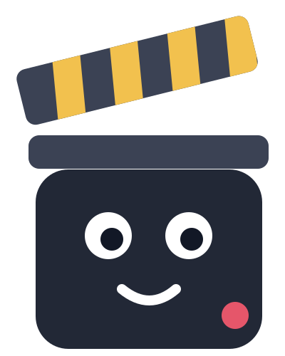

<div align="center">



# Clipper

**Record your screen, edit it into a polished clip, and annotate screenshots, all on your Mac.**

Vertical (9:16) and landscape (16:9) screen recordings with a camera that follows your cursor, automatic zooms, webcam layouts, local captions, trim and cut, and a full screenshot editor with callouts, arrows and image merging. Native, fast, and private: nothing leaves your Mac.

macOS 15+ · Apple Silicon · Free and open source

</div>

---

## Contents

- [What it does](#what-it-does)
- [Install](#install)
- [First launch and permissions](#first-launch-and-permissions)
- [Quick start](#quick-start)
- [Keyboard shortcuts](#keyboard-shortcuts)
- [Where your files go](#where-your-files-go)
- [Privacy](#privacy)
- [Build from source](#build-from-source)
- [Project layout](#project-layout)
- [Contributing](#contributing)
- [Credits and license](#credits-and-license)

## What it does

### Screen recording

- **Record** a whole display or a region you select, plus your microphone and webcam (each on its own track, so you can change the layout after recording).
- **A small control bar** while recording: time, Stop, Pause/Resume, Mute and Webcam on/off. Clipper's own windows are never in the recording.
- **Pause and resume** without gaps or freezes in the final video; muting records silence, so audio stays in sync.
- **A live webcam bubble** while you record, which you can place anywhere afterwards.

### Editing a recording

- **Format:** 9:16 for TikTok, YouTube Shorts and Instagram/Facebook Reels, or 16:9 for YouTube, LinkedIn and X, at 1080p or 720p.
- **Camera that follows your cursor:** it stays still while you work and moves only when the cursor reaches the edge, so viewers never lose it.
- **Zooms:** added automatically around your clicks, or by hand on the timeline. Each one follows the cursor or holds a fixed point, at 1.25× to 3×.
- **Webcam layouts:** a circle or rounded square in any corner, or a split screen.
- **Trim and cut:**
  - drag the clip's ends, split at the playhead, delete a part
  - unlimited undo
  - 15 ms audio crossfades, so there are no pops at a cut
  - your original recording is never modified
- **Timeline:** thumbnails, an audio waveform to spot mistakes and silence, plus webcam and caption tracks.
- **Captions:**
  - transcribed on your Mac (whisper.cpp), never uploaded
  - editable line by line
  - styled: font, colors, outline, pill, word highlight, position
- **Click highlights:** a ripple on every click.
- **Backgrounds:**
  - 576 gradients, animated gradients that loop seamlessly, 50 built-in images, your own photos, or solid colors
  - padding, rounded corners and shadows

### Export

- **Formats:** MP4 (with audio and an optional `.srt`), GIF and animated WebP.
- **Size estimates** before you export, with a warning above your size limit.
- **What you see is what you get:** captions, webcam, zooms and click ripples are in every format.

### Screenshots

- **Take a screenshot** of a region, a window or the full screen, from the app, the menu bar, or **⌃⇧S** anywhere. Optional delay and pointer.
- **macOS screenshots too:** when you press ⌘⇧3, ⌘⇧4 or ⌘⇧5, Clipper shows its card for that screenshot as soon as it's saved.
- **A card** in the bottom-left corner: Edit, Copy, Save as or Delete (with Undo).
- **Edit any image:** drop your own PNG, JPG, HEIC and more into the Shots tab.

### Screenshot and image editor

- **Annotate:**
  - arrows, lines, shapes, text, highlighter, numbered steps, pen, emoji, stickers
  - every object stays editable, with unlimited undo
- **Hide sensitive info:** blur, pixelate or solid fill, baked into every export so it can't be undone.
- **Callout zoom:**
  - draw a box over a detail and get a sharp, magnified copy you can place anywhere, with an optional connector arrow
  - it updates live as you move the box
  - redactions always show in it
- **Reshapable arrows:**
  - Curved, Straight, Elbow or Hand-drawn
  - bend them by dragging, add points, attach their ends to objects
- **Merge images:**
  - combine 2 to 6 screenshots stacked, side by side or freely placed
  - gaps, alignment and matched edges
  - presets such as *Compare two screenshots*
- **Frame:** backgrounds, padding, corners, shadow, a macOS or browser window bar, and fixed output sizes (1:1, 4:5, 16:9, 9:16, custom).
- **Export** PNG, JPG or WebP at 1× or 2×, with no metadata, or copy to the clipboard.

### Lives in the menu bar

Close the window and Clipper keeps running quietly in the menu bar, with no Dock icon. It only watches for screenshots: the camera and microphone stay off until you record.

## Install

1. **Download** `Clipper-<version>.dmg` from the [Releases](../../releases) page.
2. **Open** the `.dmg` and **drag Clipper onto the Applications folder** shortcut.
3. **Eject** the disk image, then open Clipper from Applications or Spotlight.

**Requirements:** an Apple Silicon Mac (M1 or later) with macOS 15 Sequoia or later. Nothing else to install: ffmpeg ships inside the app.

### "Clipper can't be opened" / "Apple could not verify…"

Release builds may not be signed with an Apple Developer ID, so macOS blocks the first launch. To allow it once:

1. Open Clipper. When macOS warns you, click **Done** (or **Cancel**).
2. Open **System Settings → Privacy & Security**, scroll down, and click **Open Anyway** next to the message about Clipper.
3. Confirm with **Open Anyway** and your password or Touch ID.

You only need to do this once. If you prefer the terminal, this does the same thing:

```bash
xattr -dr com.apple.quarantine /Applications/Clipper.app
```

### Updating

Download the new `.dmg` and drag Clipper into Applications again, choosing **Replace**. Your settings, screenshots and recordings stay where they are.

### Uninstalling

Drag Clipper from Applications to the Trash. To remove its data too, delete `~/Library/Application Support/Clipper`. Your recordings in `~/Movies/Clipper` and screenshots in `~/Pictures/Clipper` are yours to keep or delete.

## First launch and permissions

macOS asks for each permission the first time Clipper needs it:

| Permission | Why | Without it |
|---|---|---|
| **Screen Recording** | Recording and screenshots | Clipper can't capture the screen |
| **Microphone** | Your voice in recordings | Video only, no audio |
| **Camera** | The webcam track | No webcam |

If you said no by mistake, turn it on in **System Settings → Privacy & Security** and restart Clipper. After granting Screen Recording, macOS may ask you to quit and reopen the app.

## Quick start

**Record a clip**

1. Pick the format and webcam layout in **Layout**, and a background in **Scene**.
2. Click **Record** (or choose **Region** first to record part of the screen).
3. Click **Stop** on the control bar (or press **⌥⇧S**).
4. Trim, cut, adjust zooms and captions on the timeline, then click **Export**.

**Annotate a screenshot**

1. Press **⌃⇧S** anywhere, or use macOS's own ⌘⇧4.
2. Click **Edit** on the card that appears.
3. Annotate, then **Copy**, **Save** or **Export**.

**Compare two screenshots**

1. In the **Shots** tab, tick two screenshots and click **Merge**.
2. In the editor's **Merge** panel, click **Compare two screenshots**.
3. Move the callouts and bend the arrow to taste.

## Keyboard shortcuts

**Anywhere** (change them in `~/Library/Application Support/Clipper/hotkeys.conf`)

| Action | Keys |
|---|---|
| Take a screenshot | ⌃⇧S |
| Pause / resume recording | ⌥⇧P |
| Stop recording | ⌥⇧S |

**Recording editor**

| Action | Keys |
|---|---|
| Play / pause | Space |
| Split at the playhead | S |
| Delete the selected part | ⌫ |
| Undo / redo | ⌘Z / ⌘⇧Z (or ⌘Y) |
| Step one frame / one second | ← → / ⇧← ⇧→ |
| Start / end | Home / End |
| Add a zoom | Z |
| Zoom the timeline | ⌃ + scroll, − / + |

**Screenshot editor**

| Action | Keys |
|---|---|
| Select, Arrow, Callout, Line | V, A, O, L |
| Rectangle, Rounded, Ellipse | R, U, E |
| Text, Highlighter, Steps, Pen | T, H, N, P |
| Emoji, Stickers, Hide info | J, K, B |
| Crop, Frame, Merge | C, G, M |
| Duplicate, lock | ⌘D, ⌘L |
| Bring forward / back | ⌘] / ⌘[ (⇧ for front/back) |
| Paste an image | ⌘V |
| Copy result, save, export | ⌘C, ⌘S, ⌘E |
| Fit / 100% | ⌘0 / ⌘1 |
| Pan | Space-drag or two-finger scroll |

## Where your files go

| What | Where |
|---|---|
| Exported videos, GIFs, WebPs | `~/Movies/Clipper` (changeable in Output) |
| Screenshots and edits | `~/Pictures/Clipper` (changeable in Shots) |
| Recording sessions (raw tracks, edits, captions) | `~/Movies/Clipper/.sessions` |
| Settings, hotkeys, caption models, your backgrounds | `~/Library/Application Support/Clipper` |

Screenshot edits are saved as a project file next to the original (`*.clipper.json`). It keeps the **unedited** original, so share the exported image, not the project file.

## Privacy

Clipper works entirely on your Mac. There's no account, no analytics and no cloud.

The only network request it ever makes is downloading a caption model from Hugging Face, and only when you click **Download** in the Captions tab. Models are verified by SHA256 and stored locally.

## Build from source

**You need:**

- macOS 15+ on Apple Silicon
- [Rust](https://rustup.rs) (stable)
- Xcode command line tools: `xcode-select --install`
- Homebrew packages: `brew install ffmpeg cmake` (CMake builds whisper.cpp)

**Run it:**

```bash
cargo run --release
```

When run from a terminal, macOS asks the *terminal app* for Screen Recording and Microphone permission.

**Test it:**

```bash
cargo test
```

The tests render real images and encode real video, so ffmpeg needs to be on your `PATH`. End-to-end tests that record the actual screen are opt-in:

```bash
cargo test -- --ignored --nocapture
```

**Build the app and a `.dmg`:**

```bash
scripts/bundle.sh
```

This creates `dist/Clipper.app` and `dist/Clipper-<version>.dmg`. It bundles a static, checksum-verified FFmpeg (downloaded by `scripts/fetch-ffmpeg.sh`), so users don't need anything installed.

- `scripts/bundle.sh --gpu` runs speech to text on the GPU (Metal).
- **Without** a Developer ID, the app is signed ad hoc and users allow it once (see [Install](#install)).
- **With** a Developer ID, set these to sign with the hardened runtime, notarize and staple, so the `.dmg` opens with no warning:

  ```bash
  export CLIPPER_SIGN_IDENTITY="Developer ID Application: Your Name (TEAMID)"
  export CLIPPER_NOTARY_PROFILE=clipper   # after: xcrun notarytool store-credentials clipper
  scripts/bundle.sh
  ```

**Publish a release:** create a GitHub release and attach `dist/Clipper-<version>.dmg`. Bump `version` in `Cargo.toml` first; the `.dmg` name and the app version come from it.

## Project layout

Built in Rust with [GPUI](https://www.gpui.rs) (via gpui-kit). Capture uses ScreenCaptureKit through two small Swift helpers; rendering uses tiny-skia, resvg and cosmic-text; video goes through ffmpeg.

```
src/
  main.rs            app, window, recording lifecycle
  recorder.rs        capture sessions, joining segments, cursor and webcam alignment
  timeline.rs        timeline UI and pointer gestures
  editing/           trim / split / cut: edit list, time mapping, audio crossfades (pure, tested)
  cutting.rs         the edit list wired into the app (undo, preview data)
  camera.rs zoom.rs  cursor-following camera and zoom regions
  composite.rs       the ffmpeg graph for the styled canvas
  export.rs formats.rs  MP4 / GIF / WebP export and size estimates
  frames.rs          full-rate frame cache around the playhead
  captions/          transcription, line breaking, caption rendering
  backgrounds/       gradients, animated backgrounds, image library
  screenshot/        capture, cards, library, macOS screenshot watcher
  editor/            screenshot editor: doc model, renderer, splines, merge layout, UI
  menubar.rs         menu bar icon and menu
helpers/             Swift ScreenCaptureKit helpers (built by build.rs)
scripts/             bundle.sh (app + dmg), fetch-ffmpeg.sh
docs/                design notes, e.g. state-machines.md
```

Start with [`CLAUDE.md`](CLAUDE.md) for orientation (it's useful for people, not just AI assistants): where state lives, and debug-only `CLIPPER_*` switches that open the app in any state without clicking.

## Contributing

Issues and pull requests are welcome.

- **Before changing state**, read [`docs/state-machines.md`](docs/state-machines.md). Phases that exclude each other are one enum, never a set of booleans.
- **Keep logic testable:** the time mapping, layout math, spline geometry and renderer are pure modules with unit tests, so put new logic next to them, with a test.
- **Run `cargo test`** and make sure `cargo build` and `cargo build --release` have no warnings.
- **For UI changes**, a before/after screenshot in the pull request helps a lot.

## Credits and license

Clipper builds on open-source work:

- [FFmpeg](https://ffmpeg.org), bundled as separate `ffmpeg` and `ffprobe` programs (static builds by Martin Riedl, GPLv3). Source links and the license are in the app's Credits and inside `Clipper.app/Contents/Resources`.
- [whisper.cpp](https://github.com/ggerganov/whisper.cpp) via whisper-rs, for local captions (MIT).
- [uiGradients](https://github.com/ghosh/uiGradients) and [WebGradients](https://github.com/itmeo/webgradients), for gradient presets (MIT).
- [Noto Color Emoji](https://github.com/googlefonts/noto-emoji) and [Poppins](https://fonts.google.com/specimen/Poppins) (SIL Open Font License), and [Lucide](https://lucide.dev) icons (ISC).

The full list, with license texts, is under **Credits** in the app.

Clipper is released under the MIT License; see [LICENSE](LICENSE).
